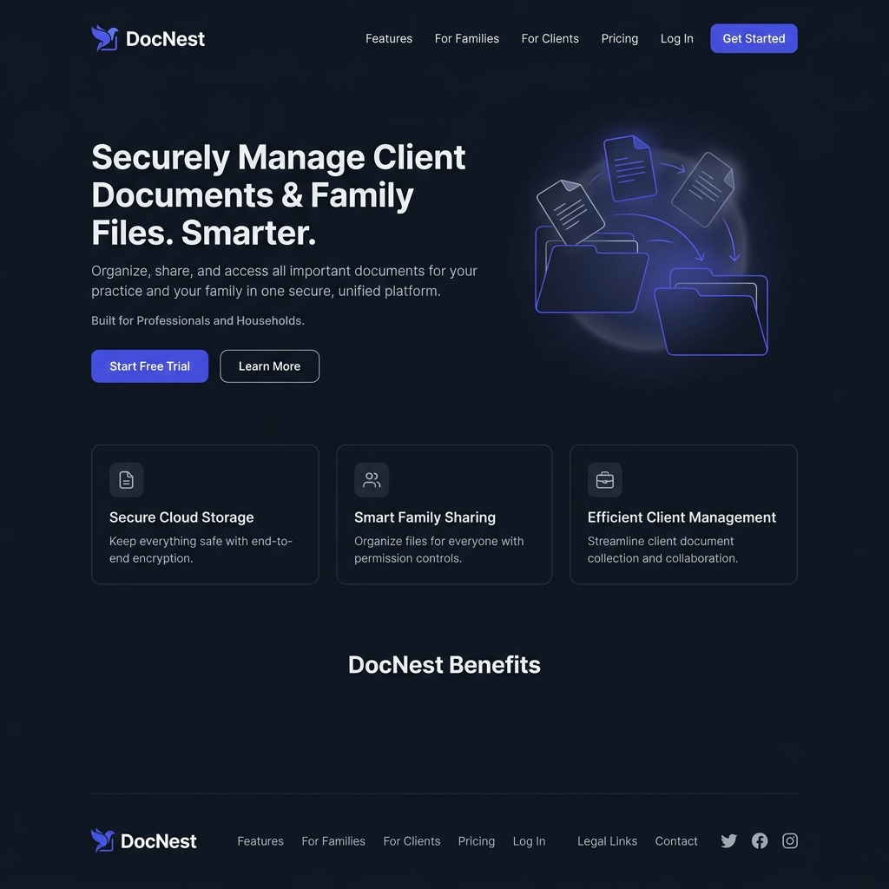
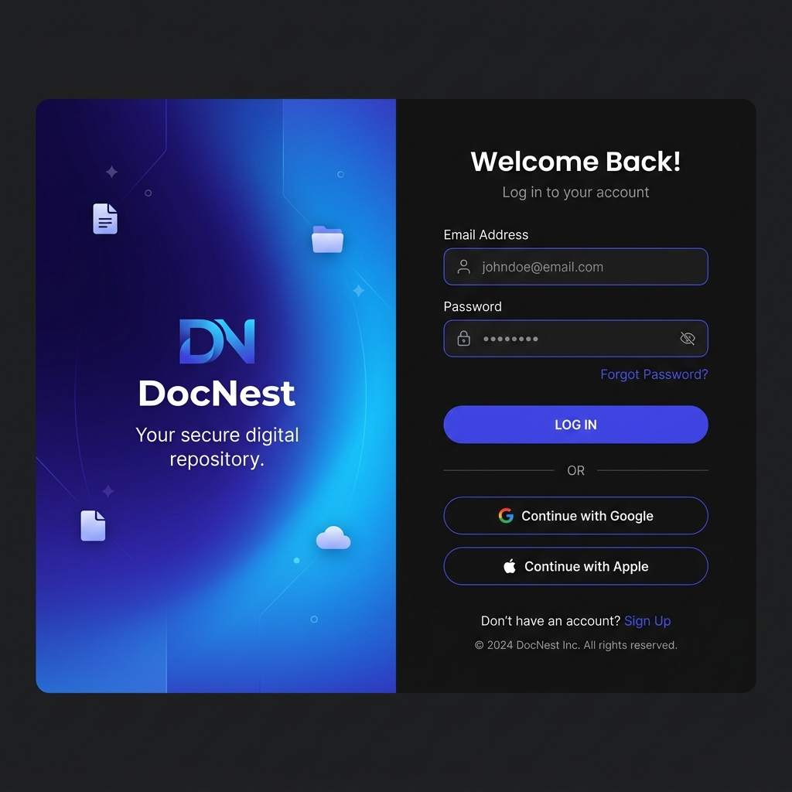
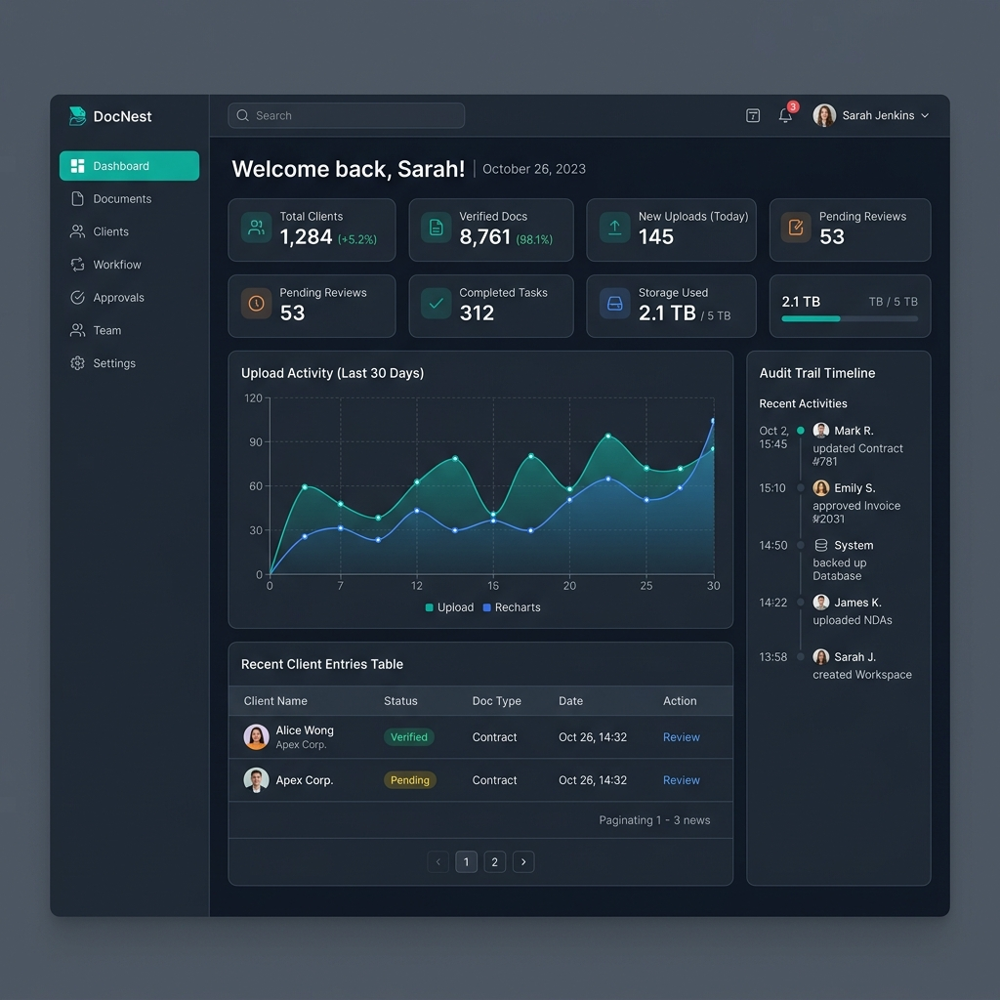
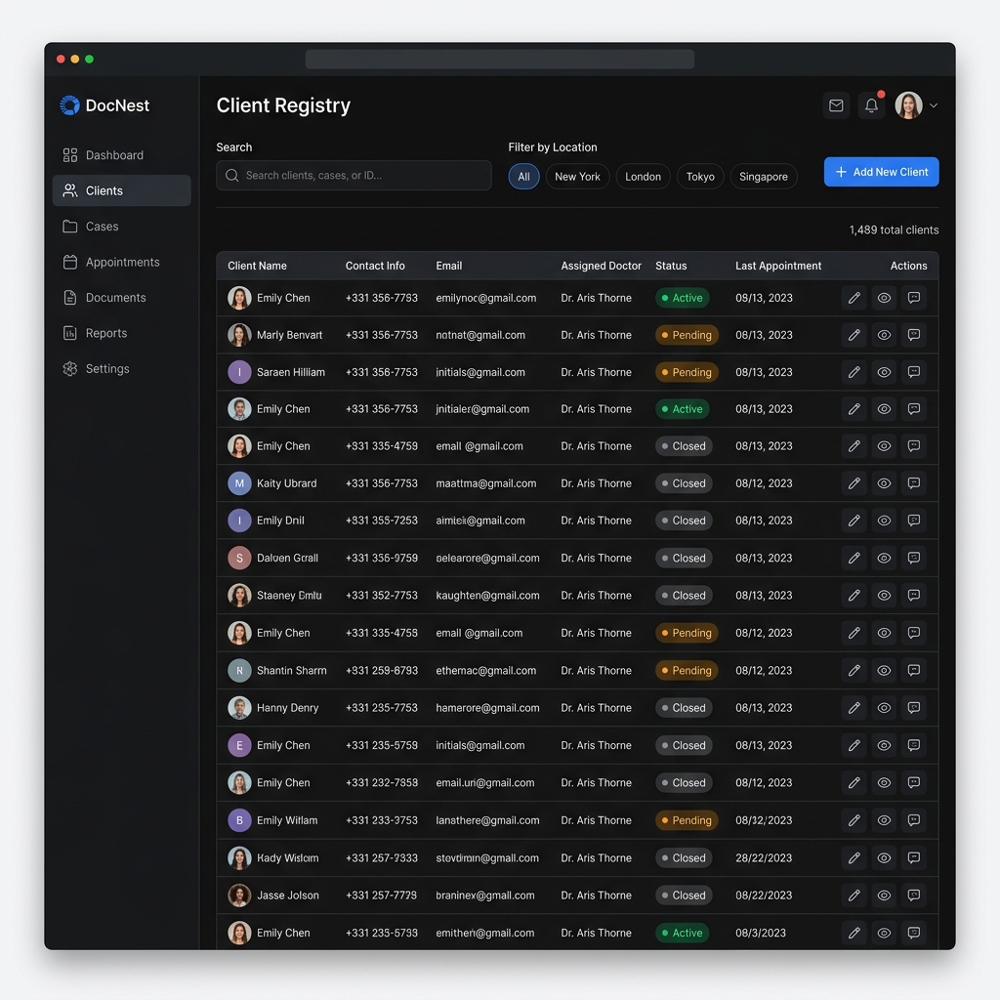
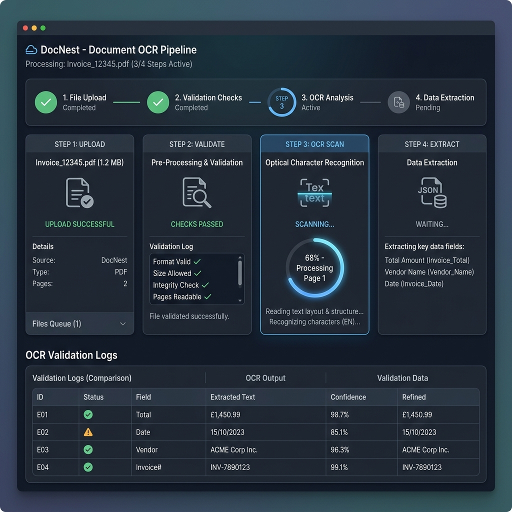
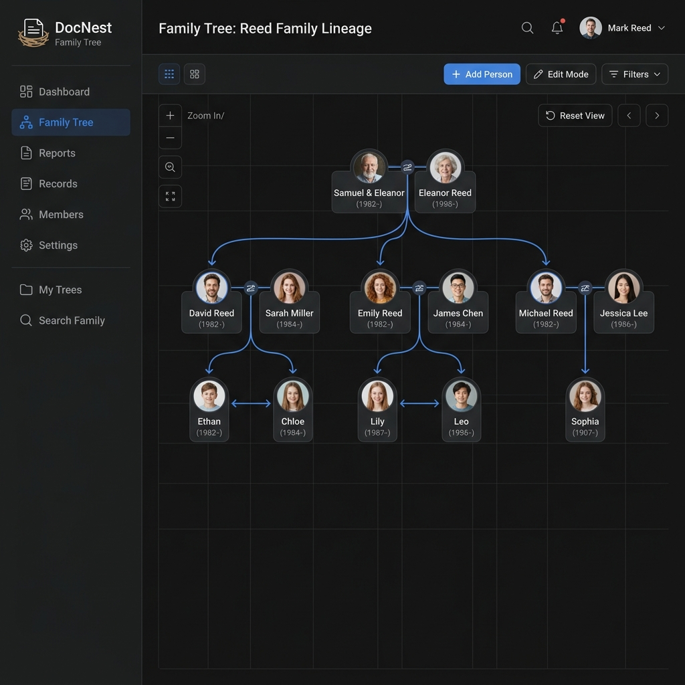

<div align="center">

# 📁 DocNest

### Smart Client Document & Family Management System

*An enterprise-ready full-stack platform designed to digitize client records, family structures, and government identity documents with browser-based OCR verification.*

<br/>

[](https://spring.io/projects/spring-boot)
[](https://react.dev/)
[](https://www.mysql.com/)
[](https://jwt.io/)
[](https://vitejs.dev/)
[](https://www.docker.com/)

<br/>

[](https://mui.com/)
[](https://github.com/naptha/tesseract.js)
[](https://www.framer.com/motion/)
[](https://render.com/)
[](https://vercel.com/)
[](LICENSE)

</div>

---

## 🌐 Live Demo & Source Code

Access the active deployment environments and the repository source files below.

<div align="center">

[](https://docnest-pink.vercel.app)
&nbsp;&nbsp;
[](https://github.com/Om-Rajpure/DocNest)

</div>

| Target Environment | Hosting Provider | Link / Access Details |
| :--- | :--- | :--- |
| **Frontend Web App** | Vercel | [https://docnest-pink.vercel.app](https://docnest-pink.vercel.app) |
| **Backend REST API** | Render | Hosted on Render Free Tier *(container sleeps on inactivity — please allow up to 30s for the initial cold-start spin-up)* |
| **Managed Database** | Aiven | Hosted MySQL Instance |
| **Source Control** | GitHub | [https://github.com/Om-Rajpure/DocNest](https://github.com/Om-Rajpure/DocNest) |

---

## 📖 Project Overview

### The Problem
In India, consulting firms, Chartered Accountants (CAs), law offices, real estate managers, and insurance brokers handle hundreds of clients daily. Each client represents a complex cluster of records, dependencies, family nominative hierarchies, and sensitive government proofs (Aadhaar cards, PAN cards, Driving Licenses, Utility bills). 

Typically, operations are bogged down by:
* ❌ **Scattered Document Silos**: Files stored across physical cabinets, WhatsApp chats, email threads, and Google Drive folders.
* ❌ **Zero Verification Mechanisms**: No way to verify document formats or numbers instantly without external, expensive validation APIs.
* ❌ **Incomplete KYC Visibility**: Difficulty determining which client is missing which document type across their entire family unit at a glance.
* ❌ **Manual Excel Onboarding Errors**: Attempting to bulk-upload lists of clients using spreadsheets with no format checking, leading to database pollution.

### The DocNest Solution
DocNest provides a centralized web vault featuring **role-based security, client-side edge OCR verification, dynamic database form controls, and automatic relationship graph mapping**. The platform moves computational overhead away from the server by parsing and validating documents directly in the client's web browser, and features a clean dashboard tracking the audit trail of every modification.

### Target Audience
* 🏢 **Insurance Brokerages**: Group KYC collection and nominee tree management.
* ⚖️ **Legal Firms**: Case dependent tracking and document status validation.
* 🧾 **CA / Tax Consultants**: Quick GST/PAN mapping, bulk uploading client lists, and tracking tax eligibility documents.
* 🏠 **Real Estate Brokers**: Document sets containing buyer, co-signer, and family details.

---

## ✨ Features

### 🔐 Authentication & Authorization
* **JWT Security Chain**: Stateless authorization implementing JSON Web Tokens (HS256 signature). Tokens are saved locally on the client and cleared automatically on expiration.
* **Granular Role Architecture**: Pre-configured roles (`ADMIN`, `MANAGER`, `EMPLOYEE`) that control screen permissions and action access.
* **BCrypt Password Hashing**: Passwords encrypted using strong BCrypt salts on the server prior to DB storage.
* **Interactive UI Safeguards**: Password complexity gauge on sign-up; automatic redirect of authenticated users away from access routes; auto-logout on unauthorized `401`/`403` API responses.

### 📊 Dashboard & System Analytics
* **Statistical Cards**: Six dynamic counts reflecting Total Clients, Active Uploaded Documents, Missing KYC Files, Total Family Members, Overall Upload Count, and Unique Location Offices.
* **Recent Signups & Timeline Grid**: Instant dashboard tables tracking the 5 latest client records.
* **Activity Logs Panel**: The 10 most recent system-wide actions displayed in chronological order on the dashboard sidebar.

### 👥 Client Registry (Full CRUD)
* **Custom Dynamic Forms**: Administrators can toggle which fields (e.g. email, gender, DOB, location) are visible or required in settings. The client form dynamically updates based on these database-driven rules.
* **Robust Verification Rules**: Checks for valid Indian mobile formats (starts with 6-9, 10 digits) and strict age constraints (18 to 100 years).
* **Grid Navigation**: Server-side pagination, search by client name or phone number, and location filtering.

### 📄 Document Vault with Client-Side OCR
* **Support for Critical Documents**: Configured to capture Aadhaar Cards, PAN Cards, Driving Licenses, and Electricity Bills.
* **Edge Processing OCR**: Drag-and-drop file uploaders (PDFs, JPGs, PNGs) pass files through a browser pipeline using [Tesseract.js](https://github.com/naptha/tesseract.js) and [PDF.js](https://mozilla.github.io/pdf.js/):
  1. **Format Validation**: Restricts uploads to valid image/PDF MIME types under 5MB.
  2. **Canvas Rendering (PDFs)**: Renders vector PDF pages to canvas bitmaps at high scale (2.0) before passing them to the OCR engine.
  3. **OCR text extraction**: OCR processing executes on client threads, displaying a real-time progress bar.
  4. **Validation Rules**: Extracts text and runs document-specific regex tests:
     * *Aadhaar*: Finds 12-digit patterns (`XXXX XXXX XXXX`, `XXXXXXXXXXXX`, `XXXX-XXXX-XXXX`) and verifies UIDAI keyword presence.
     * *PAN*: Validates structure (`[A-Z]{5}[0-9]{4}[A-Z]{1}`) and checks for Income Tax Department labels.
     * *Driving License*: Validates state-code formats (`MH12`, `DL04`, etc.) and transport department indicators.
     * *Electricity Bill*: Checks for energy-billing keywords ("unit", "bill amount", "consumer number").
  5. **Secure Storing**: Sends verified document binary and metadata (OCR text, confidence percentage, validator state) to backend persistence.
* **Percentage KYC Tracker**: Tracks and visualizes document completeness per client and family member.
* **Interactive Inline Previews**: View image attachments in clean dialogs and PDFs inside secure sandboxed viewports.

### 🌳 Family Hierarchy Mapping
* **Dynamic Node Tree**: Renders an interactive D3 tree diagram (`react-d3-tree`) mapping relations (Spouse, Child, Parent, Sibling, Grandparent).
* **Logical Constraints**: Validation checks on member age rules relative to the main client (e.g. child cannot be older than parent; grandparent must be at least 30 years older).
* **KYC Isolation**: Each family member gets an isolated document vault showing completeness, OCR verification status, and separate preview modals.

### 📥 Excel Bulk Importing
* **Data Templates**: Excel templates are downloadable straight from the dashboard.
* **Browser Parsing**: Uses [SheetJS](https://sheetjs.com/) to parse and preview spreadsheet files on the client before submission.
* **Server Verification**: The backend parses files row-by-row using Apache POI, validating locations, phone structures, and formatting errors.
* **Partial Transactional Imports**: If single rows fail validation, the system imports the valid rows and outputs a granular error report specifying exactly which rows failed and why.

### 📝 Audit Trail Logging
* **Compliance Timelines**: Captures every document addition, client registration, edit, and deletion.
* **Structure**: Logs the operator name, action description, resource type, resource ID, and precise timestamps.
* **Color-Coded Badges**: Timeline markers denote operations (🟢 Create, 🟡 Update, 🔴 Delete) with relative formatting (e.g., "5 mins ago", "1 day ago").

---

## 🛠️ Tech Stack & Dependencies

### Technical Specs Table
| Layer | Technology | Version | Purpose |
| :--- | :--- | :--- | :--- |
| **Frontend** | React | `18.3` | SPA User Interface Library |
| **Frontend Build Tool** | Vite | `5.2` | Fast bundler & hot module dev server |
| **Styling & Components**| Material UI (MUI)| `5.15` | Theme-driven component framework |
| **Routing** | React Router DOM | `6.23` | Dynamic route mapping & guard filters |
| **OCR Engines** | Tesseract.js / PDF.js | `7.0` / `5.7` | In-browser document parsing engines |
| **Excel Parser (Client)**| SheetJS (XLSX) | `0.18` | Spreadsheet processing |
| **Charts** | Recharts | `2.12` | Aggregated analytics dashboards |
| **Animations** | Framer Motion | `12.38` | Interactive cards, modal entries, & loading skeletons |
| **HTTP Client** | Axios | `1.7` | HTTP request client with authorization interceptors |
| **Backend Framework** | Spring Boot | `3.2.5` | Production REST Core API |
| **Language** | Java | `17 (LTS)` | Backend language |
| **Security Layer** | Spring Security / JJWT | `6.x` / `0.11.5` | Stateless authentication, authorization filter, & password encoding |
| **ORM** | Spring Data JPA / Hibernate | `3.x` / `6.x` | Relational mapper and database connector |
| **Excel Processor (API)**| Apache POI | `5.2.5` | High-fidelity server-side Excel parser |
| **Connection Pooling** | HikariCP | Built-in | Connection pool management |
| **Database** | MySQL | `8.0` | Primary Relational DBMS |
| **Containerization** | Docker | Multi-stage | Secure build environments |

---

## 📸 Interface Screenshots

*Below are structural layout representations of the core app modules.*

### 🏠 1. Landing Portal & Hero

*Modern dark-themed hero with interactive Framer Motion cards, CTA buttons, pricing cards, and a direct developer contact portal.*

### 🔐 2. Authentication Interface


*Split layout with brand illustration panel, JWT storage sequence, and protected route handlers. Real-time password strength meter, client-side input validations, user role selection, and canvas confetti effects upon success.*

### 📊 3. Executive Dashboard

*Aggregated metrics displaying statistics, dynamic Recharts data, quick action routes, and real-time recent activity timeline.*

### 👥 4. Client Registry & Dynamic Creation


*Grid of clients with status indicators showing missing KYC documents, filtering by branch location, and inline search. Renders dynamically based on database visibility configs, enforcing age brackets, name formatting, and phone validations.*

### 📄 5. OCR Verification Engine & Preview


*4-step progress stepper: checking size → initializing web worker Tesseract.js → scanning document → returning pattern match. Renders images natively and hosts PDFs securely inside sandboxed iframe components with quick download tools.*

### 🌳 6. Interactive Family Hierarchy


*D3 tree showing relationships, styled nodes with initials, customizable templates, and zoom controls. Expandable lists displaying family members, custom document vaults, verification logs, and status details.*

### 📥 7. Spreadsheet Bulk Onboarding


*Drag-and-drop zone parsing files into HTML preview tables using SheetJS. Tabular response highlighting successfully imported clients and detailing validation failures for rows containing errors.*

---

## 🔄 System Architecture & Data Flow

### Request Lifecycle Flow
This diagram details the sequence of a client-side request passing through security, controllers, business services, and database persistence layers:

```
[ React UI Client ] 
        │
        │ HTTP Request with Authorization: Bearer <JWT_TOKEN>
        ▼
[ Spring Security Filter Chain ]
        │
        ├──▶ [ JwtAuthFilter ] ─────────── (Decrypt & Validate Token)
        │           │
        │           ├─ Token Expired/Invalid ──▶ Return HTTP 401 Unauthorized
        │           └─ Token Valid ────────────▶ Set Authentication Context
        ▼
[ Rest Controller Layer ] ──────────────── (Validate incoming Request DTO via @Valid)
        │
        ├──▶ (Controller: ClientController)
        ▼
[ Business Service Layer ] ─────────────── (Process transaction logic, enforce rules)
        │
        ├──▶ (Service: ClientServiceImpl) ─▶ Write Audits to [ ActivityLog ]
        ▼
[ Spring Data JPA Repositories ] ────────── (Generate SQL statements via Hibernate Dialect)
        │
        ├──▶ [ MySQL Relational Database ]
```

---

### In-Browser OCR Pipeline
DocNest bypasses expensive server-side OCR computation by executing extraction and schema regex checks directly inside the client's browser environment:

```
[ Drag & Drop File Upload ] ──▶ (PDF / PNG / JPG under 5MB)
             │
             ▼
      [ Format Filter ]
             │
             ├──▶ If Image (PNG/JPG) ────▶ Revoke URL ──▶ Run Tesseract.js Worker Thread
             └──▶ If PDF (application) ──▶ Render Page ─▶ Convert to Canvas Bitmap (Scale 2.0)
                                                                 │
                                                                 ▼
                                                        [ Tesseract.js Engine ]
                                                                 │
                                                                 ▼
                                                        [ Raw Text String ]
                                                                 │
                                                                 ▼
                                                     [ Regex Match Validation ]
                                                                 │
      ┌────────────────────────┬─────────────────────────┼─────────────────────────┐
      ▼                        ▼                         ▼                         ▼
  [ Aadhaar ]                [ PAN ]             [ Driving License ]        [ Electricity ]
  - 12 Digits               - ABCDE1234F         - State-code + 13 Digits   - Provider Keyword
  - UIDAI Keyword           - Govt. Keyword      - Transport Keywords       - Billing Keywords
      │                        │                         │                         │
      └────────────────────────┴──────────┬──────────────┴─────────────────────────┘
                                          ▼
                         [ Validation Confidence & Result ]
                                          │
                                          ▼
                      [ Send File Binary + OCR Stats to API ]
```

---

## 📁 Repository Structure

Below is the directory structure of the repository. Important files are annotated with their operational purpose.

```
DocNest/
├── 📄 render.yaml                    # Render cluster deployment instructions
├── 📄 .gitignore                     # Git configuration rules
│
├── 📂 docnest-backend/              # ☕ Spring Boot API Service
│   ├── 📄 Dockerfile                 # Multi-stage image container build config
│   ├── 📄 pom.xml                    # Maven dependency management manifest
│   └── 📂 src/main/
│       ├── 📂 java/com/docnest/
│       │   ├── 📄 DocNestApplication.java    # Application startup point
│       │   │
│       │   ├── 📂 config/                    # Context Configurations
│       │   │   ├── SecurityConfig.java       # CORS rules, filters, endpoints access controls
│       │   │   └── DataLoader.java           # CommandLineRunner seeding tables at initial launch
│       │   │
│       │   ├── 📂 controller/                # REST Controllers mapping API Endpoints
│       │   │   ├── AuthController.java       # User authentication routes
│       │   │   ├── ClientController.java     # Clients CRUD, search, and pagination
│       │   │   ├── DocumentController.java   # Document uploading, downloads, and previews
│       │   │   ├── FamilyController.java     # Family members CRUD and relation trees
│       │   │   ├── DashboardController.java  # Aggregated statistics endpoint
│       │   │   ├── ImportController.java     # Excel template downloads and spreadsheet uploads
│       │   │   ├── ActivityController.java   # Global audit action logging
│       │   │   ├── LocationController.java   # Management of branch locations
│       │   │   └── SettingsController.java   # Control configurations (fields, document toggles)
│       │   │
│       │   ├── 📂 entity/                    # JPA Hibernate Database Schemas
│       │   │   ├── User.java                 # Access credentials and permissions profiles
│       │   │   ├── Client.java               # Core client demographics records
│       │   │   ├── FamilyMember.java         # Family structures referencing clients
│       │   │   ├── Document.java             # Metadata records of uploads with OCR strings
│       │   │   ├── Location.java             # Reference list of branch offices
│       │   │   ├── ActivityLog.java          # Event logger structure
│       │   │   ├── AdminProfile.java         # Master administrators information data
│       │   │   ├── DocumentTypeConfig.java   # Dynamic rules governing file types
│       │   │   ├── FormFieldConfig.java      # Dynamic UI field configurations
│       │   │   └── SystemPreference.java     # Global system variables keys
│       │   │
│       │   ├── 📂 dto/                       # Data Transfer Objects sanitizing payloads
│       │   ├── 📂 repository/                # Query repositories communicating with MySQL
│       │   ├── 📂 service/                   # Core business logic implementation services
│       │   ├── 📂 security/                  # JWT implementation components
│       │   │   ├── JwtUtil.java              # Key generators, decryptors, and signature checkers
│       │   │   ├── JwtAuthFilter.java        # Request interceptor filtering incoming requests
│       │   │   └── CustomUserDetailsService.java # Database resolver loading auth details
│       │   └── 📂 exception/                 # Error handler mapping exceptions to HTTP errors
│       │
│       └── 📂 resources/
│           └── application.properties        # Variables mapping configurations to code
│
├── 📂 docnest-frontend/             # ⚛️ React SPA Web Client
│   ├── 📄 package.json               # NPM installation dependencies
│   ├── 📄 vite.config.js             # Bundler execution config with backend proxy paths
│   ├── 📄 vercel.json                # Vercel rewrites directing traffic to index.html
│   ├── 📄 index.html                 # DOM mounting node
│   └── 📂 src/
│       ├── 📄 main.jsx               # App entrypoint setting up DOM render rules
│       ├── 📄 App.jsx                # Router, context provider bindings, & global boundaries
│       ├── 📄 theme.js               # Material UI theme variables (Palette, Typographies)
│       │
│       ├── 📂 context/
│       │   └── AuthContext.jsx        # Login, logout, verification sessions tracker
│       │
│       ├── 📂 routes/
│       │   └── AppRoutes.jsx          # Protected route guard mappings
│       │
│       ├── 📂 services/              # API Client Request Services
│       │   ├── api.js                 # Shared Axios instance injecting Bearer tokens
│       │   ├── authService.js         # Endpoint queries for authentication
│       │   └── ...                    # Specific domain request functions
│       │
│       ├── 📂 pages/                  # Top-Level Screen Interfaces
│       │   ├── DashboardPage.jsx      # Analytics view layout
│       │   ├── ClientListPage.jsx     # Tabular registry lists
│       │   ├── SettingsPage.jsx       # Tabbed administrators configuration panel
│       │   ├── 📂 Auth/              # Login & Signup views
│       │   └── 📂 Landing/           # Brand landing page modules
│       │
│       ├── 📂 components/            # Reusable Interface Modules
│       │   ├── 📂 layout/            # Navigation drawers, appbars
│       │   ├── 📂 document/          # OCR drag-and-drop file cards
│       │   ├── 📂 family/            # Hierarchy tree modules
│       │   └── 📂 ui/               # Confirmation modals, cards, skeletons
│       │
│       ├── 📂 utils/                 # Frontend Utility Libraries
│       │   ├── formatters.js          # Raw values visual decorators
│       │   ├── validators.js          # Client-side input format checks
│       │   ├── documentValidators.js  # Document OCR Regex validations
│       │   └── ocrService.js          # PDF conversion and OCR worker pipelines
│       │
│       └── 📂 styles/
│           ├── variables.css          # Color pallets and border variables
│           └── global.css             # Main styling configurations
│
└── 📂 Documents/                     # OCR Validation Sample files
    ├── Adhar Card.png
    ├── Pan Card.jpg
    ├── Driving Licence.jpg
    ├── Electric Bill.png
    └── DocNest.pdf
```

---

## 🗄️ Database Design & Models

### Schema Relationships
The relationship design between key models in the DocNest database:

```
                  ┌────────────────────────┐
                  │          User          │
                  │   - id (PK)            │
                  │   - role (Enum)        │
                  └────────────────────────┘
                              
                  ┌────────────────────────┐             ┌────────────────────────┐
                  │         Client         │ M : 1       │        Location        │
                  │   - id (PK)            │────────────▶│   - id (PK)            │
                  │   - location_id (FK)   │             │   - location_name      │
                  └────────────────────────┘             └────────────────────────┘
                              │
                              │ 1 : N
                              ▼
                  ┌────────────────────────┐
                  │      FamilyMember      │
                  │   - id (PK)            │
                  │   - client_id (FK)     │
                  └────────────────────────┘
                              
 ┌────────────────────────────────────────────────────────┐
 │                        Document                        │
 │   - id (PK)                                            │
 │   - owner_type (String: "CLIENT" / "FAMILY_MEMBER")    │ ◀── Polymorphic Link
 │   - owner_id (Long: maps to Client ID or Member ID)   │     (No FK constraint)
 └────────────────────────────────────────────────────────┘
```

---

### Polymorphic Document Ownership Architecture
A key engineering decision in DocNest is **Polymorphic Association** for documents. Instead of creating two separate tables (`client_documents` and `family_member_documents`) or implementing multi-column nullable foreign keys, DocNest utilizes a single `document` table mapped with two fields:
1. `ownerType`: Indicates the model type owning the document (e.g., `"CLIENT"` or `"FAMILY_MEMBER"`).
2. `ownerId`: Represents the primary key ID of either the `Client` or the `FamilyMember`.

#### Benefits of this approach:
* **Database Cleanliness**: Unified schema configuration for document metadata (filename, path, MIME type, OCR confidence, OCR text).
* **Extensibility**: Easily allows new document-owning models (e.g., `Employee`, `Partner`) to be added in the future without schema updates.
* **Code Reusability**: Single backend repository (`DocumentRepository`) and service interface (`DocumentService`) process all document transactions.

> [!NOTE]
> Database level referential integrity (Foreign Key constraints) is not enforced on `ownerId` since it resolves to multiple parent tables. Integrity is maintained at the application service layer via transactional checks.

---

### Database Dictionary

#### `users` Table
Stores login credentials and roles.
* `id` (BIGINT, PK, AUTO_INCREMENT)
* `full_name` (VARCHAR)
* `email` (VARCHAR, UNIQUE)
* `password` (VARCHAR, BCrypt hash)
* `role` (VARCHAR: `ADMIN`, `MANAGER`, `EMPLOYEE`)

#### `client` Table
Main registry containing client records.
* `id` (BIGINT, PK, AUTO_INCREMENT)
* `first_name` (VARCHAR)
* `last_name` (VARCHAR)
* `mobile` (VARCHAR)
* `dob` (DATE)
* `gender` (VARCHAR)
* `email` (VARCHAR)
* `address` (TEXT)
* `location_id` (BIGINT, FK to `location_master`)

#### `family_member` Table
Maintains family relations linked to client profiles.
* `id` (BIGINT, PK, AUTO_INCREMENT)
* `client_id` (BIGINT, FK to `client`)
* `member_name` (VARCHAR)
* `relation` (VARCHAR)
* `dob` (DATE)
* `gender` (VARCHAR)
* `mobile` (VARCHAR)
* `email` (VARCHAR)

#### `document` Table
Stores uploaded file locations and extracted OCR metadata.
* `id` (BIGINT, PK, AUTO_INCREMENT)
* `owner_type` (VARCHAR: `"CLIENT"`, `"FAMILY_MEMBER"`)
* `owner_id` (BIGINT)
* `document_type` (VARCHAR: `"AADHAR"`, `"PAN"`, `"DRIVING_LICENSE"`, `"ELECTRICITY_BILL"`)
* `file_name` (VARCHAR)
* `file_path` (VARCHAR)
* `mime_type` (VARCHAR)
* `file_size` (BIGINT)
* `ocr_confidence` (DOUBLE)
* `ocr_extracted_text` (LONGTEXT)

---

## 🔌 API Endpoints

### 🔑 Authentication (`/api/auth`)
| Method | Endpoint | Description | Role Requirement |
| :--- | :--- | :--- | :--- |
| `POST` | `/api/auth/register` | Create a new user profile | ❌ Public |
| `POST` | `/api/auth/login` | Validate credentials & issue JWT | ❌ Public |
| `GET` | `/api/auth/me` | Fetch active user credentials | ✅ Token Required |

### 👥 Client Management (`/api/clients`)
| Method | Endpoint | Description | Role Requirement |
| :--- | :--- | :--- | :--- |
| `POST` | `/api/clients` | Register a new client profile | ✅ Token Required |
| `GET` | `/api/clients` | Fetch paginated, filterable client list | ✅ Token Required |
| `GET` | `/api/clients/{id}` | Get client details by ID | ✅ Token Required |
| `PUT` | `/api/clients/{id}` | Update client demographics | ✅ Token Required |
| `DELETE` | `/api/clients/{id}` | Remove client from database | ✅ `ADMIN`, `MANAGER` |

### 📄 Document Operations (`/api/documents`)
| Method | Endpoint | Description | Role Requirement |
| :--- | :--- | :--- | :--- |
| `POST` | `/api/documents/upload` | Upload new document (multipart request) | ✅ Token Required |
| `PUT` | `/api/documents/replace/{id}`| Replace files and overwrite OCR metadata | ✅ Token Required |
| `GET` | `/api/documents/owner/{type}/{id}`| Fetch all documents of a target owner | ✅ Token Required |
| `GET` | `/api/documents/completion/{type}/{id}`| Get document verification percentages | ✅ Token Required |
| `GET` | `/api/documents/preview/{id}`| Retrieve secure stream for file displaying | ✅ Token Required |
| `DELETE` | `/api/documents/{id}` | Delete document file and metadata | ✅ `ADMIN`, `MANAGER` |

### 🌳 Family Management (`/api/family`)
| Method | Endpoint | Description | Role Requirement |
| :--- | :--- | :--- | :--- |
| `POST` | `/api/family` | Add family member linked to client | ✅ Token Required |
| `PUT` | `/api/family/{id}` | Edit family member credentials | ✅ Token Required |
| `GET` | `/api/family/client/{id}`| Fetch flat list of client family members | ✅ Token Required |
| `GET` | `/api/family/tree/{id}` | Fetch nested family tree structure | ✅ Token Required |
| `DELETE` | `/api/family/{id}` | Remove family member | ✅ Token Required |

### ⚙️ System Settings & Tools
| Method | Endpoint | Description | Role Requirement |
| :--- | :--- | :--- | :--- |
| `GET` | `/api/dashboard/stats` | Fetch real-time dashboard analytics counters | ✅ Token Required |
| `GET` | `/api/activity` | Retrieve full chronological audit timeline | ✅ Token Required |
| `GET` | `/api/activity/recent` | Fetch top 10 recent activities | ✅ Token Required |
| `GET` | `/api/locations` | Fetch master list of branch offices | ✅ Token Required |
| `POST` | `/api/locations` | Create a new branch office location | ✅ `ADMIN` |
| `POST` | `/api/import/excel` | Bulk upload client list (multipart file) | ✅ Token Required |
| `GET` | `/api/import/template` | Download spreadsheet onboarding template | ✅ Token Required |
| `GET` | `/api/settings/form-fields` | Retrieve client form validation setup | ✅ Token Required |
| `PUT` | `/api/settings/form-fields` | Configure client form visibility schema | ✅ `ADMIN` |
| `GET` | `/api/settings/preferences` | Retrieve system preferences configs | ✅ Token Required |
| `PUT` | `/api/settings/preferences` | Update system preferences rules | ✅ `ADMIN` |

---

## 🚀 Installation & Setup

Follow these steps to run the complete environment locally.

### Prerequisites
* **Java JDK 17 (LTS)**
* **Node.js v18 or later**
* **MySQL v8.0 or later**
* **Maven v3.9 or later**
* **Git**

---

### Step 1: Clone Repository
```bash
git clone https://github.com/Om-Rajpure/DocNest.git
cd DocNest
```

---

### Step 2: Configure MySQL Database
Access your MySQL server using your command line client or management UI:
```sql
CREATE DATABASE docnest;
CREATE USER 'docnest_user'@'localhost' IDENTIFIED BY 'Password123#';
GRANT ALL PRIVILEGES ON docnest.* TO 'docnest_user'@'localhost';
FLUSH PRIVILEGES;
```

---

### Step 3: Setup Backend Environment Configs
Navigate into `docnest-backend` directory and create a configuration `.env` file:
```bash
cd docnest-backend
touch .env
```
Paste the following values inside `.env`:
```env
DB_URL=jdbc:mysql://localhost:3306/docnest?useSSL=false&allowPublicKeyRetrieval=true&serverTimezone=UTC
DB_USERNAME=docnest_user
DB_PASSWORD=Password123#
JWT_SECRET=a8b340cf3914a84f3e69f88d22ef1492c30089e09dcd294715f5c9e2b1cd5f32
JWT_EXPIRATION=86400000
CORS_ORIGINS=http://localhost:5173,http://localhost:5174
UPLOAD_DIR=uploads
PORT=8080
```

---

### Step 4: Run the Backend REST Server
Build and boot the Spring Boot application using Maven wrappers:
```bash
# On Windows Command Prompt/PowerShell:
mvnw.cmd spring-boot:run

# On macOS / Linux:
chmod +x mvnw
./mvnw spring-boot:run
```
The REST API will launch at `http://localhost:8080`.
Upon the initial database mapping sequence, JPA auto-generates tables, and `DataLoader.java` seeds:
1. Standard Maharashtra location offices (Mumbai, Pune, Navi Mumbai, etc.)
2. Form schema configurations
3. Required Document types mapping
4. Admin profile (`admin@docnest.com`) and default preferences keys.

---

### Step 5: Setup Frontend Web App Configs
Open another terminal window, navigate to the frontend directory, and create a local config environment file:
```bash
cd ../docnest-frontend
touch .env.local
```
Add the following line inside `.env.local`:
```env
VITE_API_URL=http://localhost:8080
```

---

### Step 6: Install Frontend Dependencies & Start Web Server
```bash
# Install NPM packages
npm install

# Start Vite bundler dev server
npm run dev
```
The application will launch locally at `http://localhost:5173`.
Navigate your browser to `http://localhost:5173` to access the application.

---

## 🔐 Environment Variables

Detailed configurations parameters descriptions:

### Backend Configuration Parameters (`docnest-backend/.env`)
| Environment Key | Required | Default Value | Description |
| :--- | :--- | :--- | :--- |
| `PORT` | ❌ | `8080` | Port on which the Spring Boot server executes |
| `DB_URL` | ✅ | — | JDBC MySQL driver connection URL |
| `DB_USERNAME` | ✅ | — | Username authorized on the MySQL schemas |
| `DB_PASSWORD` | ✅ | — | Password authorized on the MySQL schemas |
| `JWT_SECRET` | ✅ | — | 256-bit cryptographically secure token signing key |
| `JWT_EXPIRATION` | ❌ | `86400000` | Token expiration duration (Default: 24h) |
| `CORS_ORIGINS` | ❌ | `http://localhost:5173` | Allowed network origins mapping HTTP calls |
| `UPLOAD_DIR` | ❌ | `uploads` | Root directory storing physical user files |

### Frontend Configuration Parameters (`docnest-frontend/.env.local`)
| Environment Key | Required | Default Value | Description |
| :--- | :--- | :--- | :--- |
| `VITE_API_URL` | ✅ | `http://localhost:8080` | Entrypoint REST URL of the backend server API |

---

## ☁️ Deployment Guide

DocNest is architected for simple cloud provisioning.

### ☕ Spring Boot REST Deployment (Render Docker)
The backend is packaged using a multi-stage Docker setup. It builds the distribution artifact and launches it on a secure runtime environment.
1. Create a **Web Service** on Render and link your Git repository.
2. In configurations, select **Docker** as the runtime.
3. Configure the path variables:
   * **Dockerfile Path**: `./docnest-backend/Dockerfile`
   * **Docker Build Context**: `./docnest-backend`
4. Under Environment variables, configure the variables specified in the [Backend Environment Configs](#step-3-setup-backend-environment-configs) section.
5. In Render, map the `DB_URL` to your production database URL (e.g. Aiven managed MySQL instance).

---

### ⚛️ Frontend Web App Deployment (Vercel)
Vercel hosts the static output files of the frontend React app.
1. Create a project on Vercel and import the repository.
2. Set the **Root Directory** configurations parameter to: `docnest-frontend`.
3. Set the **Build Command** parameter to `npm run build` and output directory to `dist`.
4. Inject the environment variable parameter:
   * `VITE_API_URL` ──▶ *Production Backend URL on Render*
5. Deploy. The project configuration file `vercel.json` automatically handles routing rewrites, resolving all virtual routes to `index.html` to prevent router failure on page refresh.

---

## 🧗 Challenges Faced & Engineering Solutions

### 1. In-Browser OCR Accuracy & Canvas Scale Constraints
Running OCR processing on the client side with Tesseract.js introduces processing limitations compared to server-side engines. Raw files uploaded directly from mobile phone cameras are often angled, blurry, or low-contrast. 

* **The Fix**: Before sending files to Tesseract.js, the utility pipeline checks the file type. If the file is a PDF, PDF.js renders the pages to an off-screen HTML canvas. The canvas rendering scale is adjusted to `2.0` (doubling resolution width and height) to enhance character sharpness.
* Additionally, instead of relying on exact string outputs, the regex validation framework matches against robust patterns (e.g. tracking spaces in Aadhaar numbers, looking for state-codes in Driving Licenses) to handle OCR character variations.

### 2. Polymorphic Entity Relationships
Decoupled entities like `Client` and `FamilyMember` both require a list of associated files. Using traditional JPA join-table relations would require creating redundant tables or mapping multiple nullable foreign keys in the `document` schema, leading to sparse tables.

* **The Fix**: Designed a polymorphic relationship model in the JPA entity:
  ```java
  @Column(name = "owner_type")
  private String ownerType; // "CLIENT" or "FAMILY_MEMBER"
  
  @Column(name = "owner_id")
  private Long ownerId;
  ```
  The service layer resolves parent references programmatically, allowing a single `Document` entity to serve both client files and family member files without database constraint overhead.

### 3. Handle Render Free Tier Cold Starts
Because the backend is hosted on Render's free tier, the container shuts down after 15 minutes of inactivity. The next incoming API request takes ~30 seconds to boot the container, which can cause standard frontend API client requests to time out.

* **The Fix**: Configured the Axios client wrapper `api.js` with an extended timeout configuration of `60000ms` (60 seconds) to handle cold starts. Friendly, animated loaders and explanations are displayed to the user during the initial startup delay.

---

## 📚 Key Learnings & Skills Gained

* **Spring Security & Stateless Security**: Gained experience setting up filters (`OncePerRequestFilter`), managing security context holders, configuration of CORS mappings, and hashing user credentials with BCrypt.
* **Asynchronous Web Workers**: Utilized web workers in React through Tesseract.js to run computationally intensive OCR scanning on background threads, keeping the browser UI fluid and responsive.
* **Relational Database Design**: Designed clean database schemas in MySQL, managing one-to-many relationships (Clients to Family Members) and custom data-loader scripts using `CommandLineRunner`.
* **Dynamic Content Mapping**: Built administrative panels that store form configurations in a database, allowing administrators to modify client onboarding forms at runtime.

---

## 🔮 Future Improvements

* **AWS S3 / GCS Document Persistence**: Replace local server storage with distributed S3 bucket uploads to support horizontal scaling.
* **Granular Role Permissions (RBAC)**: Expand security models with micro-permissions configuration dashboards (e.g. letting employees view files but restricting download capabilities).
* **Automated Expiry Alerts**: Track document validity details (e.g. driving license expirations) and notify managers via email (using SendGrid or Spring Mail) 30 days before document expiration.
* **Offline PWA Support**: Configure Service Workers to cache user data, allowing employees to register clients and collect pictures offline and sync them to the database when connectivity is restored.

---

## 🎯 Technical Interview Preparation (Supercharged)

*This section provides detailed answers to common architectural and technical questions regarding the project.*

<details>
<summary><b>Q1: Can you explain the technical architecture of DocNest?</b></summary>
<p>
DocNest is built on a decoupled <b>Client-Server Architecture</b>. 

* **Frontend**: A React Single Page Application (SPA) bundled with Vite. It manages state via React hooks and context variables (`AuthContext`) and handles asynchronous requests to the API using Axios.
* **Backend**: A Spring Boot REST API structured around MVC design patterns (Controllers, Services, Repositories). It uses Spring Security with stateless JWT configurations to secure all endpoint groups.
* **Database**: MySQL relational database schemas mapped through Spring Data JPA and Hibernate.
* **Hosting**: The React UI client is hosted on Vercel, the Java container is hosted on Render, and MySQL schemas are hosted on a managed Aiven instance.
</p>
</details>

<details>
<summary><b>Q2: Why did you choose MySQL over MongoDB for this application?</b></summary>
<p>
I chose a <b>Relational Database (MySQL)</b> because the core data model contains highly structured, normalized data with strong relationships. 
* A client record maps directly to multiple family members, which maps to specific documents. 
* Core system functions like the <b>Family Tree</b> depend on strict parent-child hierarchies. MySQL's referential integrity (foreign keys) helps maintain database consistency.
* MongoDB could handle document storage, but managing relationships (like cascades, joins, and aggregates for branch metrics) would require complex application-layer code. MySQL performs these operations efficiently at the database layer.
</p>
</details>

<details>
<summary><b>Q3: Why run Tesseract OCR on the frontend? What are the architectural trade-offs?</b></summary>
<p>
Running OCR on the client using Tesseract.js and PDF.js was a deliberate design choice with several trade-offs:
* **Cost & Scalability (+)**: Running OCR in the browser uses the user's local hardware instead of backend CPU cycles, saving on hosting costs and server resources.
* **Reduced Server Load (+)**: The Spring Boot API server only processes file uploads and database writes, rather than CPU-heavy image parsing.
* **Latency (+)**: Users get real-time feedback on document validity before their files are uploaded.
* **Accuracy (-)**: Browser-based OCR is slightly less accurate than cloud APIs (like Google Cloud Vision). I mitigated this by building image pre-processing steps (rendering PDFs to canvas at scale 2.0) and regex validators to handle OCR character variations.
</p>
</details>

<details>
<summary><b>Q4: How does JWT-based stateless authentication work in DocNest?</b></summary>
<p>
When a user logs in:
1. The credentials (email and password) are sent to `/api/auth/login`.
2. The backend validates them using Spring Security's `AuthenticationManager`. Passwords are checked against the BCrypt hash stored in the database.
3. If validation succeeds, the backend generates an HS256-signed JWT token containing the user's email, role, and expiration timestamp.
4. The token is sent to the client, which stores it in `localStorage`.
5. For all subsequent requests, an Axios request interceptor attaches the token in the `Authorization: Bearer <token>` header.
6. On the backend, a custom `JwtAuthFilter` intercepts the request, validates the token signature and expiration, extracts the user details, and sets the authentication context for that request.
</p>
</details>

<details>
<summary><b>Q5: Explain the Polymorphic Document model. How is it implemented in JPA without Foreign Keys?</b></summary>
<p>
To allow both <code>Client</code> and <code>FamilyMember</code> entities to own documents, I implemented a polymorphic design in the <code>Document</code> entity:
```java
@Entity
@Table(name = "document")
public class Document {
    @Id
    @GeneratedValue(strategy = GenerationType.IDENTITY)
    private Long id;
    
    @Column(name = "owner_type")
    private String ownerType; // "CLIENT" or "FAMILY_MEMBER"
    
    @Column(name = "owner_id")
    private Long ownerId; // PK of the Client or FamilyMember
}
```
* **Implementation**: We do not configure `@ManyToOne` or `@JoinColumn` relationships on `ownerId` because it points to different tables.
* **Resolving Ownership**: The application's service layer handles these associations. When retrieving documents, we query:
  `documentRepository.findByOwnerTypeAndOwnerId(ownerType, ownerId)`.
* **Trade-off**: This design keeps the database schema clean and extensible, but requires the application layer to enforce referential integrity (e.g. cascading deletes) programmatically since the database lacks foreign keys.
</p>
</details>

<details>
<summary><b>Q6: How does the Excel bulk import validate data, and how are errors reported?</b></summary>
<p>
The bulk onboarding import pipeline processes spreadsheets row-by-row:
1. The frontend parses the file using **SheetJS** to display a quick data preview to the user.
2. The user submits the file, and the backend receives the multipart spreadsheet.
3. The API uses **Apache POI** to read the spreadsheet rows.
4. Each row is validated against specific criteria:
   * **Required fields check**: First Name, Last Name, and Mobile must be present.
   * **Format verification**: Indian phone number rules and date formats are verified.
   * **Database verification**: Branch locations are matched against the location master database.
5. If a row passes validation, a new `Client` entity is created and saved. If validation fails, the row is skipped, and the error details are recorded.
6. The API returns a summary report containing the total rows processed, success count, failure count, and a list of failed rows with their row numbers and specific validation errors.
</p>
</details>

<details>
<summary><b>Q7: What was the most challenging bug or technical hurdle in this project, and how did you resolve it?</b></summary>
<p>
The most challenging part was parsing multi-page PDF documents for OCR in the browser. Tesseract.js only accepts image objects (PNG/JPG/bitmaps). Passing a raw PDF file to Tesseract directly fails.
* **The Solution**: I integrated **PDF.js** to render PDF pages into images in the browser. I wrote a wrapper function that loads the PDF file, iterates through its pages, and renders each page to an off-screen HTML5 canvas element.
* We set the canvas scale to `2.0` to render the text at high resolution, improving OCR extraction accuracy.
* The canvas content is then converted into an image blob using `canvas.toBlob()`, which is passed to Tesseract.js for scanning.
* I used async/await and `Promise.all` to coordinate the page rendering and OCR processes, ensuring they execute sequentially without blocking the browser UI thread.
</p>
</details>

---

## 👥 Author & Social Connections

<div align="center">

| Profile | Links & Badges |
| :--- | :--- |
| **Om Rajpure** <br/> *Full Stack Developer* <br/><br/>  | [](https://conceptsin5.com/) <br/><br/> [](https://github.com/Om-Rajpure) <br/><br/> [](https://www.linkedin.com/in/om-rajpure) <br/><br/> [](https://www.instagram.com/conceptsin5) <br/><br/> [](https://www.youtube.com/@conceptsin5) |

<br/>

*Built with ❤️ in India 🇮🇳*

</div>

---

## 🤝 Contribution Guidelines

Contributions are welcome! Please follow these steps to contribute:

1. **Fork** the repository.
2. **Create a branch** for your feature:
   ```bash
   git checkout -b feature/your-feature-name
   ```
3. **Commit your changes** using [Conventional Commits](https://www.conventionalcommits.org/):
   ```bash
   git commit -m "feat: add secure document encryption on backend"
   ```
4. **Push your changes** to your fork:
   ```bash
   git push origin feature/your-feature-name
   ```
5. **Create a Pull Request** describing your changes and any relevant context.

---

## 📄 License

This project is licensed under the **MIT License** — see the [LICENSE](LICENSE) file for details.
You are free to use, modify, and distribute this software for personal and commercial purposes.
